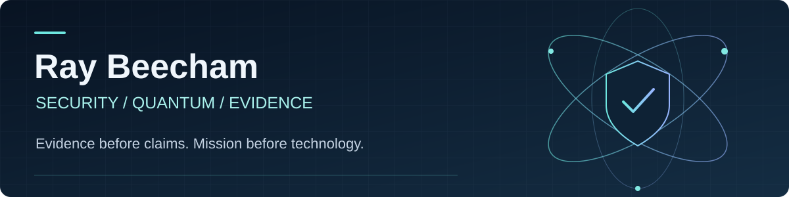

<picture>
  <source media="(max-width: 600px)" srcset="assets/profile-banner-mobile.svg">
  
</picture>
<!-- QPU-RUN:START -->
<sub>The circuit in the banner ran on IBM Quantum <b>ibm_fez</b> on Oct 26, 2026; its output bits replay 8 of 1,024 measured shots (most common outcome <code>0000</code>, 30%). [Run data](assets/qpu-run.json)</sub>
<!-- QPU-RUN:END -->

**Turning technical evidence into decisions people can explain.**

I build security tools, research systems, and hands-on quantum experiments. My work connects **post-quantum cryptography, cryptographic discovery, applied AI, and technology evaluation**, with traceable evidence and human review built into the workflow.

[Live signal](#user-content-live-signal) · [Public projects](#user-content-public-projects) · [Professional experience](#user-content-professional-experience) · [Background](#user-content-background) · [EvidenceOS](https://raybeecham.github.io/raybeecham/) · [LinkedIn](https://linkedin.com/in/RaymondBeecham)

<a id="live-signal"></a>
##  Live from the research desk

<!-- FRONTIER-SIGNAL:START -->
**Rising this week:** ↗ Quantum Hardware · ↗ Quantum Software / Tooling · ↗ Quantum Sensing · ↗ AI Security

- → **QEC / Fault Tolerance** · [Alice & Bob Reports Phase 1 Results of France’s PROQCIMA Quantum Program](https://quantumcomputingreport.com/alice-bob-reports-phase-1-results-of-frances-proqcima-quantum-program) <sub>Quantum Computing Report, Oct 21</sub>
- ↗ **Quantum Hardware** · [China’s Tuoyuan Targets Neutral-Atom Quantum Computing](https://thequantuminsider.com/2026/10/19/chinas-tuoyuan-targets-neutral-atom-quantum-computing) <sub>The Quantum Insider, Oct 19</sub>
- → **PQC / Crypto Agility** · [How to evaluate a post-quantum cryptography provider: 10 questions to ask](https://pqshield.com/post-quantum-cryptography-provider) <sub>PQShield, Oct 23</sub>

<sub>Machine-selected from the [Frontier Signal](https://raybeecham.github.io/quantum-research-scout/) evidence ledger · updated 2026-10-26 00:54 UTC · headlines are not reviewed or endorsed.</sub>
<!-- FRONTIER-SIGNAL:END -->

<a id="public-projects"></a>
##  Public projects

Personal research and open-source work, separate from my professional engagements.

### [Frontier Signal](https://github.com/raybeecham/quantum-research-scout)
**Research intelligence** · [Open the desk →](https://raybeecham.github.io/quantum-research-scout/)

Source-linked briefings across cybersecurity, PQC, quantum computing, AI, and cloud. Notebooks and investigation workspaces keep evidence, interpretation, uncertainty, and human review visible. The feed above comes straight from its daily evidence ledger.

### [PQC Readiness War Room](https://github.com/raybeecham/pqc-readiness-war-room)
**Security engineering** · [Try the demo →](https://pqc-readiness-war-room.raybeecham2009.workers.dev/)

An edge demo explaining observable TLS and HTTPS posture while keeping missing PQC and crypto-agility evidence visible. Modern transport signals do not establish ML-KEM support or enterprise migration readiness.

### [Quantum Oncology Benchmark](https://github.com/raybeecham/quantum-oncology-benchmark)
**Reproducible research**

Strong classical baselines and quantum-kernel experiments with training-only preprocessing, shared partitions, provenance, and statistical checks. The classical reference evaluation is complete; quantum nested cross-validation is planned. Research only, with no quantum-advantage or clinical-validation claim.

<details>
<summary><strong>More from the workbench</strong>: crypto inventory, AI systems handbook, PKI labs, Chrono</summary>

- **[Crypto Inventory Demo](https://github.com/raybeecham/crypto-inventory-demo)** · CodeQL discovery for Java and Python, TLS configuration, and runtime observations. Normalized inventory, risk summary, and CI enforcement for critical findings.
- **[AI Systems Engineering Handbook](https://github.com/raybeecham/claude-certified-associate-foundations)** · Original scenario-based study materials and a vendor-neutral playbook for designing, evaluating, securing, and governing AI workflows. Unofficial learning resource.
- **[Modern Practical PKI](https://github.com/raybeecham/modern-practical-pki)** · Docker and OpenSSL exercises in encoding, hashing, randomness, ASN.1, and key generation. Later certificate and TLS chapters are planned.
- **[Chrono](https://github.com/raybeecham/Chrono)** · An OpenAI Build Week historical prototype: a reconstructed 1998 desktop, period-aware AI dialogue, anachronism detection, and a deterministic offline fallback.

</details>

**[Explore EvidenceOS →](https://raybeecham.github.io/raybeecham/)** My interactive portfolio, with mission routing, sample decision replay, a research network, and quantum-architecture exploration.

##  Engineering principles

**Evidence before claims. Strong baselines before conclusions.**

Preserve provenance. Make uncertainty visible. Design for reproducibility. Keep security boundaries explicit and decisions accountable to people. A model, score, or prototype supports a decision; it does not authorize deployment or operational action.

<!-- CRYPTO-SCAN:START -->
<!-- CRYPTO-SCAN:END -->

<a id="professional-experience"></a>
##  Professional experience

**Accenture Federal Services** · Quantum Security &amp; Cryptographic Engineering

Post-quantum readiness, crypto-agility, technical assessment, and applied quantum research: cryptographic-inventory reviews, NIST guidance commentary, a co-authored PQC risk whitepaper, vendor pilots, and hybrid quantum-classical experiments on real hardware.

<details>
<summary><strong>Six workstreams in detail</strong></summary>

#### 01 / PQC readiness &amp; crypto-agility
- Support federal PQC readiness through cryptographic-inventory reviews, discrepancy resolution, and migration-evidence assessment.
- Developed and delivered stakeholder briefings and a program webinar on federal cryptographic inventory requirements, connecting technical work with planning and reporting.

#### 02 / Assessment methods &amp; evidence
- Contribute to assessments across PKI, cloud, data, networking, mobile systems, and analysis of alternatives. Developed project scope, methodology, questionnaires, and supporting architecture and inventory documentation.
- Develop reusable workflows and prototype AI-assisted evidence review using synthetic data, source provenance, quote checks, explicit findings rules, and recorded human decisions.

#### 03 / Research, standards &amp; publications
- Authored technical summaries and formal review comments on NIST guidance for key generation, digital signatures, storage confidentiality, and cryptographic module validation.
- Co-authored a published whitepaper on operationalizing cryptographic risk for PQC migration and contribute recurring quantum-safe research communications.

#### 04 / Technology pilots &amp; partner evaluation
- Led a scoped PQC vendor pilot and recurring technical presentations, coordinating work from scoping through demonstration.
- Coordinated quantum/PQC partner engagements, technical deep dives, and capability reviews. Conducted vendor-landscape research with comparison criteria and sources.

#### 05 / Applied quantum experimentation
- Collaborated on hybrid quantum-classical fraud-detection experiments and live demonstrations using quantum hardware.
- Built educational quantum cryptographic attack demonstrations and reproducible demo environments supported by setup documentation, debugging, integration tests, and validated baseline releases.

#### 06 / Hands-on learning &amp; enablement
- Developed self-paced quantum workshop materials connecting Python, machine inspection, hardware selection, and small circuit experiments with explanations and troubleshooting.
- Continue developing interactive quantum learning tools and practical colleague demonstrations that distinguish simulation, hardware execution, and experimental limitations.

</details>

<details>
<summary><strong>Tools and methods</strong></summary>

- **Security:** PQC, cryptographic inventory, TLS, PKI, OpenSSL, CodeQL, crypto-agility.
- **Software:** Python, TypeScript, JavaScript, Docker, GitHub Actions, Cloudflare Workers.
- **Research and AI:** Qiskit, quantum kernels, classical baselines, statistical evaluation, provenance, structured outputs, and human-reviewed workflows.

</details>

<a id="background"></a>
<details>
<summary><strong>Background, credentials, and education</strong></summary>

U.S. Navy veteran with interests spanning federal cybersecurity, cloud, DevSecOps, and applied quantum systems.

**Selected credentials:** GIAC Certified Intrusion Analyst (GCIA), AWS Certified Solutions Architect - Associate, ISC2 Systems Security Certified Practitioner (SSCP), CompTIA Security+, Q-CTRL Quantum Professional, SandboxAQ AQtive Guard Certified Practitioner, and D-Wave Quantum Programming - Core.

**Education:** M.S. in Information Systems with a cybersecurity concentration from Texas A&M University-Central Texas, and B.B.A. in Computer Information Systems from Texas State University.

</details>

<details>
<summary><strong>For codebreakers</strong></summary>

```
DCDM PELL, KHTYCZXQEFZ. XLCEMGSY CMYELF KEQCNA. LQS IQ HD FJVDUXJV
TJ LBGFEHEJXUWIIF QHE UXDNJWG JBF EHHX TCIULQWLYNJWG.
```

A classical cipher from 1553 guards this one. Its key is the smallest unit of quantum information.

</details>

🔏 **Quantum-safe contact:** my ML-DSA-65 public key is fingerprint `59d86286…7737afe5`. [Key, signed statement, and how to verify it](keys/README.md).

---

<sub>Views are my own. Public projects are personal research, learning, and open-source work. Prototypes and research outputs are decision support, not employer or client positions, procurement authorization, clinical advice, or operational approval.</sub>
